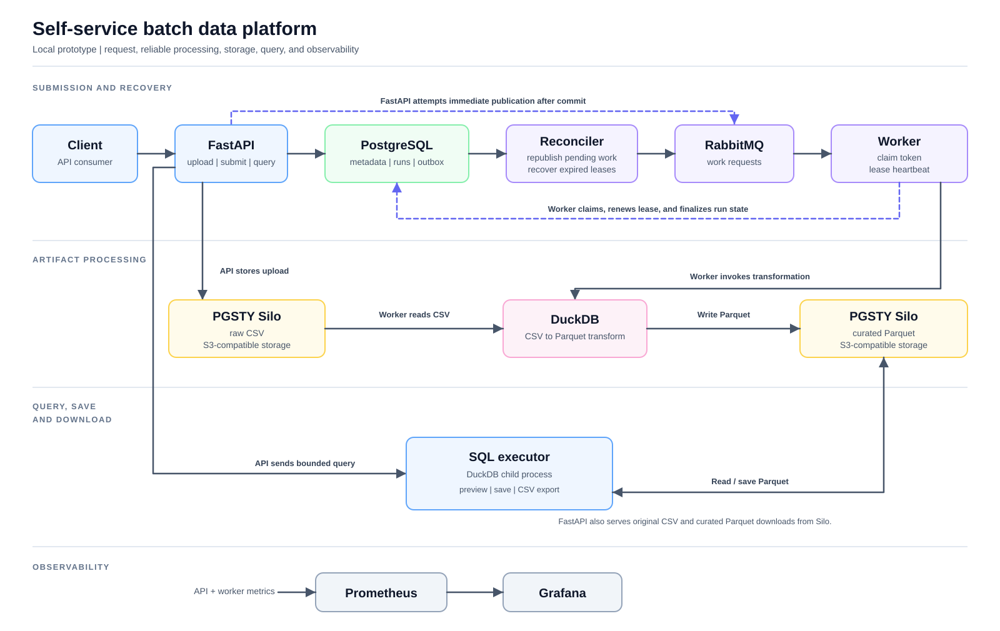

# Self-Service Batch Data Platform

An API-based self-service prototype for batch data. It lets someone register a CSV, start processing, check progress, and query or download the result without building and operating a separate pipeline.

## Problem and scope

An internal analyst or developer may need the same upload, validation, transformation, and result-access steps for each new batch file. This project models a platform that provides those steps through one API. It is a portfolio prototype for a hypothetical internal user; it does not claim adoption by a real team or production readiness.

## Architecture



FastAPI registers datasets, stores original CSV files in PGSTY Silo, and records metadata in PostgreSQL. A processing run and its outbox intent commit together. FastAPI attempts immediate publication to RabbitMQ; the reconciler republishes pending intents and recovers expired processing leases. The worker claims a run with a token, validates the CSV, transforms it with DuckDB, writes an attempt-specific Parquet artifact, and updates run state in PostgreSQL.

For previews, saved tables, and CSV exports, FastAPI reads curated Parquet from Silo and invokes a bounded DuckDB child process. It also serves original CSV and Parquet downloads. Silo is S3-compatible, and the application uses the MinIO Python SDK to access it. Prometheus collects API and worker metrics for Grafana.

The [architecture decisions](docs/architecture-decisions.md) explain the component choices. The [query and download guide](docs/query-tables.md) describes the API boundaries.

## Run locally

Prerequisites: Docker with Compose and free localhost ports 5432, 8000, 9000, 9001, 9090, 3000, and 15672. Python 3.11 is needed for the optional verification commands. In PowerShell from the repository root:

```powershell
if (-not (Test-Path .env)) { Copy-Item .env.example .env }
docker compose up -d --build
docker compose ps
Invoke-RestMethod http://127.0.0.1:8000/health
Invoke-RestMethod http://127.0.0.1:8000/db-health
```

For Bash, use `cp -n .env.example .env` before `docker compose up -d --build`. The demo credentials in `.env.example` are for this disposable local environment only. Open the [interactive API documentation](http://127.0.0.1:8000/docs), [Grafana](http://127.0.0.1:3000), or [Prometheus](http://127.0.0.1:9090). The object-store console is at [localhost:9001](http://127.0.0.1:9001).

Fresh PostgreSQL volumes receive the schema from `db/init.sql`. An existing volume is not reinitialized by `docker compose up`; apply any missing migrations in `db/migrations/` before starting the newer API and worker. In particular, a database created before the reliability update needs [migration 005](db/migrations/005_review_reliability.sql):

```powershell
docker compose up -d db
Get-Content .\db\migrations\005_review_reliability.sql -Raw | docker compose exec -T db sh -c 'psql -v ON_ERROR_STOP=1 -U "$POSTGRES_USER" -d "$POSTGRES_DB"'
docker compose up -d --build
```

Use that command only for a database that still needs migration 005. Migration 005 is repeatable, but historical `running` rows without leases need operator review. Named volumes preserve data across container replacement; they are not backups. Changing `.env` passwords does not rotate credentials already stored in existing volumes.

## Verify the workflow

With the Compose stack running, install the test dependencies and run the smoke test:

```powershell
python -m pip install -r requirements-dev.txt
python scripts/verify_saved_tables.py
```

The script creates a synthetic three-row CSV, checks the original download, waits for processing, previews and saves a regional query, downloads Parquet and CSV, and queries a derived grand total. Expected results are `north = 30`, `south = 5`, and `grand_total = 35`. Success prints the created IDs as JSON. The sample records remain in the current stack.

Run the unit and API suite with `python -m pytest -q`. [GitHub Actions](https://github.com/RoieMugi/self-service-data-platform/actions) uses the same [docker-compose.yml](docker-compose.yml) in a fresh runner, then removes its volumes. It runs the smoke test plus recovery and boundary checks. The [verification guide](docs/verification.md) maps the checks to their claims and limits.

## Scope and limits

This is a single-machine learning prototype. Compose binds exposed ports to `127.0.0.1`. There is no user authentication, LAN access, web UI, backup and restore workflow, or public multi-user SQL sandbox. Query admission is limited to one API process; DuckDB's memory setting is not an operating-system memory quota. An uncertain object write can leave an orphan for the read-only object audit to report. Existing MinIO data volumes have not been migration-tested against the pinned Silo image used by the current Compose configuration.

The [Terraform](Terraform/README.md) and [Kubernetes](kubernetes/README.md) directories are separate API-only learning labs, not deployments of the full pipeline.
