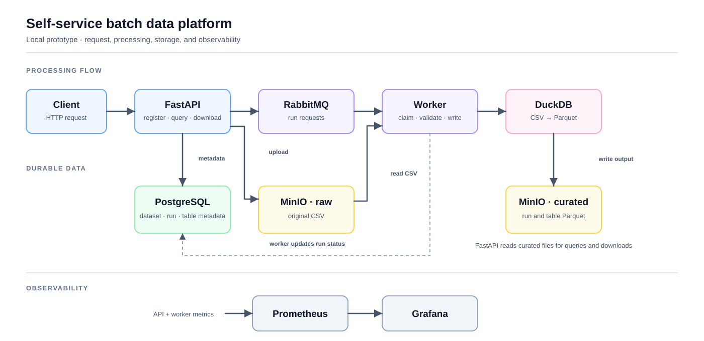
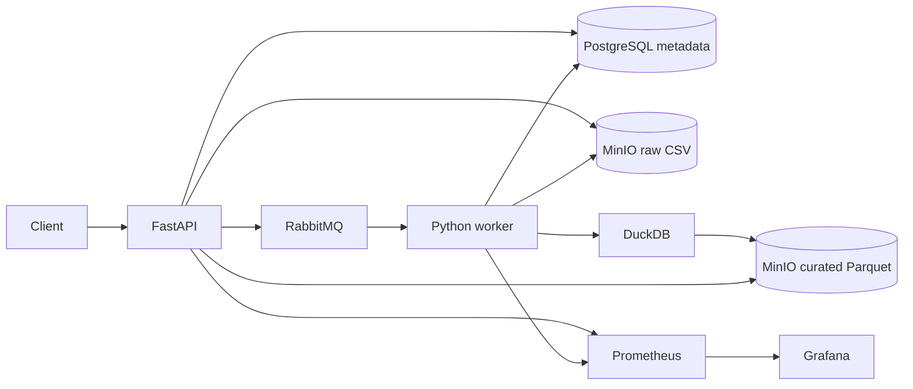

# Self-Service Batch Data Platform

Register a CSV dataset, submit an asynchronous processing run, then query or download its Parquet output. This local portfolio prototype shows the full path from an HTTP request through a durable run record, queue-backed worker, object storage, and a saved result.

## What it does

1. Register a dataset and upload a CSV through FastAPI.
2. Store the original file in MinIO and record metadata in PostgreSQL.
3. Submit a processing run to RabbitMQ; a separate worker validates the CSV and writes Parquet with DuckDB.
4. Read run status, preview bounded SQL queries, save derived tables, and download CSV or Parquet results.
5. Inspect JSON logs, Prometheus metrics, Grafana dashboards, and basic alert rules.

This is a **local learning system**. Its API has no user authentication, the included credentials are disposable demo values, and its SQL executor is not a public multi-user sandbox. Compose publishes its ports only on `127.0.0.1`.

## Architecture





PostgreSQL is the source of truth for run state. RabbitMQ carries work requests; the worker claims a queued run before processing it. See [queue behavior and recovery limits](PROJECT_HISTORY.md#queued-run-preparation) and the [query guide](docs/query-tables.md) for implementation details.

## Quick start

Prerequisites: Docker with Compose and free local ports 5432, 8000, 9000, 9001, 9090, 3000, and 15672. Python 3.11 is needed for the optional smoke test and pytest. Compose uses a pinned Silo image, a MinIO-compatible S3 store, because the former MinIO container repositories are unavailable for fresh pulls. From the repository root in PowerShell:

```powershell
if (-not (Test-Path .env)) { Copy-Item .env.example .env }
docker compose up -d --build
docker compose ps
Invoke-RestMethod http://127.0.0.1:8000/health
Invoke-RestMethod http://127.0.0.1:8000/db-health
```

For a retained PostgreSQL volume created before this review, apply [migration 005](db/migrations/005_review_reliability.sql) **before rebuilding the API or worker**. The owner's local database received this migration on 2026-11-14; do not reapply it there. For another existing database, from PowerShell while its database service is running:

```powershell
Get-Content .\db\migrations\005_review_reliability.sql -Raw | docker compose exec -T db sh -c 'psql -v ON_ERROR_STOP=1 -U "$POSTGRES_USER" -d "$POSTGRES_DB"'
docker compose up -d --build
```

Fresh volumes receive the same schema from `db/init.sql`. The migration is repeatable; it does not reclaim historical `running` rows whose lease is unknown.

Open [API docs](http://127.0.0.1:8000/docs), [Grafana](http://127.0.0.1:3000), or [Prometheus](http://127.0.0.1:9090). The MinIO console is at [localhost:9001](http://127.0.0.1:9001). Credentials are in your local `.env`, copied from [.env.example](.env.example). Do not reuse those values outside this disposable demo.

For a complete upload, process, query, and saved-table smoke test, install the test dependencies on the host and run:

```powershell
python -m pip install -r requirements-dev.txt
python scripts/verify_saved_tables.py
```

On Bash, start with `cp -n .env.example .env && docker compose up -d --build`; then run the same Python commands. The smoke test uses a synthetic three-row sales CSV. It expects north=30, south=5, and grand total=35; it checks the original CSV, processed Parquet, saved-table Parquet, and CSV export. A successful run prints the created IDs as JSON. It retains those sample records in the current stack. See the [query and download routes](docs/query-tables.md) for the individual API calls.

Run the automated suite with `python -m pytest -q`. CI has separate unit and disposable Compose integration jobs; the latter has not yet produced a recorded passing clean-stack result in this review.

Fresh PostgreSQL volumes are initialized by `db/init.sql`. Existing volumes are **not** reinitialized on `docker compose up`; apply only the migrations they still need from `db/migrations/`. Changing `.env` passwords does not rotate credentials already stored in PostgreSQL, RabbitMQ, MinIO, or Grafana volumes. Named volumes preserve local data across container replacement and are not backups.

## Current status and limits

The Compose workflow and backend features through Session 022 are implemented. Session 023 reproduced the separate Terraform API lab and reviewed CI. **The owner marked Phase 1 complete on 2026-11-11. The Review and Improvement Phase is active; Phase 2 has not started.** [R01](docs/review-phase/R01-run-artifacts.md) gave each new processing run its own Parquet key. The owner reported 201 passing tests and live verification of distinct downloadable run artifacts. For R02, the owner reported **202 passing tests**; the live smoke test hit a 10-second query deadline on the retained local stack, so [clean-stack acceptance remains pending](docs/review-phase/R02-clean-stack-verification.md).

The R06–R10 code adds leased run attempts, a recovery reconciler, a transactional publication outbox, process-local query admission, a read-only object inventory, and optional idempotency keys for saved tables. The focused automated tests pass, but a clean-stack live fault-injection run has **not** verified these changes yet. See the [implementation checkpoint](docs/review-phase/R06-R10-implementation.md). The Terraform and Kubernetes directories are separate **API-only learning labs**, not deployments of the complete pipeline. Kubernetes' earlier host-port database connection is affected by the loopback-only Compose binding; see its [updated lab guide](kubernetes/README.md). LAN access, authentication, backup and restore, a web UI, and durable event streaming remain future work.

## Project records

- [Query, saved table, and download guide](docs/query-tables.md)
- [Review findings and improvement roadmap](docs/review-phase/ROADMAP.md)
- [Session index and verification records](docs/sessions/README.md)
- [Historical project journal and operational notes](PROJECT_HISTORY.md)
- [Terraform API lab](Terraform/README.md) and [Kubernetes API lab](kubernetes/README.md)
- [Original study notes](Platform_Engineering_Study_Notes.md)
