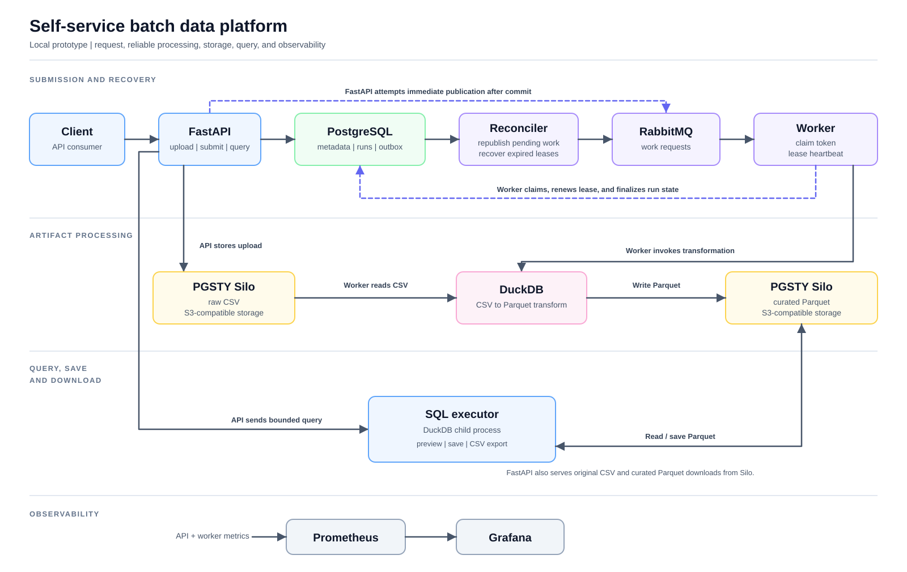

# Architecture and design decisions

This is a local, single-machine prototype. The diagram shows the services that handle a request, the durable state used for recovery, and the separate path for querying results.

## How a run moves through the platform

1. FastAPI registers a dataset, stores its uploaded CSV in PGSTY Silo, and records metadata in PostgreSQL.
2. Submitting work commits a queued run and an outbox intent in one PostgreSQL transaction. FastAPI attempts to publish the request to RabbitMQ immediately.
3. The reconciler republishes pending outbox intents. It also detects expired worker leases and requeues eligible runs or marks exhausted runs failed.
4. A worker claims a queued run with a token and renewable lease. It reads the raw CSV, uses DuckDB to validate and transform it, writes attempt-specific Parquet to Silo, and finalizes the run in PostgreSQL. The token prevents an expired attempt from finalizing a newer result.
5. FastAPI reads curated Parquet for bounded SQL previews, saved tables, and CSV exports through a DuckDB child process. It also serves original CSV and Parquet downloads. Prometheus collects API and worker metrics for Grafana.

## Why these components

- **PostgreSQL owns metadata, run state, and the outbox.** A transaction keeps the run and publication intent together. Conditional updates make claims atomic and finalization token-aware.
- **PGSTY Silo stores CSV and Parquet bytes.** It exposes an S3-compatible API; the application uses the MinIO Python SDK. PostgreSQL stores object keys rather than file contents. Attempt-specific paths keep stale workers from overwriting newer output.
- **RabbitMQ carries work requests.** Publisher confirms and the reconciler handle publication uncertainty. Duplicate deliveries are expected and resolved through PostgreSQL claims.
- **DuckDB transforms and queries files.** A separate child process gives each query a deadline and resource settings. The API admits a bounded number of queries per process; this is not hard isolation for public, untrusted SQL.

The [query guide](query-tables.md) lists API routes and limits. The [verification map](verification.md) shows which behavior the automated and live checks cover. Existing PostgreSQL volumes need applicable migrations, and named storage volumes are not backups.
