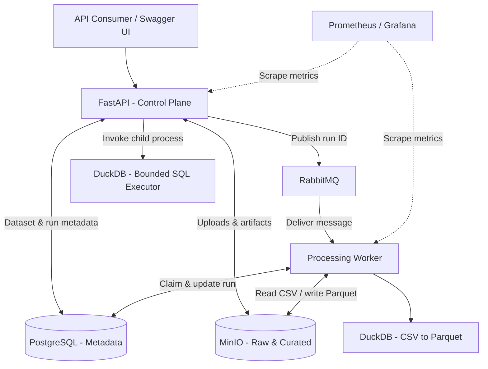

# Self-Service Data Platform — Portfolio Review & Implementation Handoff

**Repository:** https://github.com/RoieMugi/self-service-data-platform
**Review date:** 2026-11-11
**Reviewed revision:** `97421c2ad6461258ab6a0f23f8e8111be648c8ab` (main at review time)
**Audience:** Project owner, human collaborators, coding agents
**Status:** Recommendations only. **No repository files were changed during this review.**

> **How to use this document:** This is a standalone, actionable handoff distilled from two hiring-manager reviews and a deeper inspection of the public repository. It is not a verbatim transcript. Start with the prioritized tasks, verify current code before making changes, and treat production-oriented ideas as optional unless the owner approves them.

## 1. Objective and hiring assessment

Make the existing project a credible, easily understood portfolio piece for **Junior / Mid-Level Data Platform Engineer** applications **without exaggerating its capabilities** or expanding its scope unnecessarily.

- **Revised portfolio presentation score:** **7.5/10** (earlier, less thorough review: 7.8/10). These are subjective hiring-manager assessments, not code-quality measurements.
- **Junior-level:** Strong interview signal; the project demonstrates meaningful software and platform engineering concepts.
- **Mid-level:** Promising but needs clearer architectural justification, reliability understanding, and maintainability evidence.
- **Primary problem:** The engineering implementation is stronger than the first impression conveyed by the README and GitHub landing page. The repository reads partly like a detailed learning journal rather than a polished product demonstration.
- **Primary recommendation:** Improve presentation and reproducible evidence before adding more technology.

## 2. Verified capabilities and evidence

| Area | Implemented evidence | Important qualification |
|---|---|---|
| API | FastAPI endpoints for dataset registration, CSV uploads, processing runs, saved tables, queries and downloads | API-driven self-service, not a graphical portal |
| Metadata | PostgreSQL datasets, uploads, processing runs, saved tables and constraints | No user/tenant ownership or access control |
| Object storage | MinIO raw CSV and curated Parquet | Metadata and object writes are not atomic |
| Async jobs | RabbitMQ publisher, separate worker, HTTP 202, run polling, durable messages, publisher confirmations, manual ack | No transactional outbox, automatic recovery of interrupted running jobs, or comprehensive retries |
| Concurrency | Conditional PostgreSQL update claims queued run; worker prefetch 1 | Not evidence of distributed-scale throughput or global concurrency control |
| Data processing | DuckDB converts CSV to Parquet | Batch CSV only; 10 MiB upload limit |
| Querying | Separate DuckDB child process; SELECT-only, deadline, row/size constraints; save derived tables and CSV exports | One selected artifact per query; not a public SQL security sandbox; no cross-dataset joins |
| Observability | Structured logs, correlation IDs, Prometheus API/worker metrics, Grafana provisioning and alert rules | No external alert delivery; dashboard visual verification was deferred in session records |
| Local deployment | Docker Compose with API, worker, DB, MinIO, RabbitMQ, Prometheus, Grafana | Local demo, not cloud production deployment |
| Infrastructure labs | Terraform local API-only lab and Kubernetes API-only lab | Neither is a full platform deployment; Kubernetes lab has retained dependencies on Compose |
| Tests | GitHub Actions on main ran `python -m pytest -q`: **200 passed, 1 warning in 5.16s**, 2026-11-11, commit above | CI mocks external services; does **not** launch full Compose stack or verify live broker/storage/database workflow |
| Smoke test | `scripts/verify_saved_tables.py` exercises register → upload → process → poll → query → save → derive | Requires live local services; currently not part of CI |

**Important sources:** `README.md`, `app/main.py`, `app/worker.py`, `app/messaging.py`, `app/query_executor.py`, `db/init.sql`, `docker-compose.yml`, `.github/workflows/tests.yml`, `scripts/verify_saved_tables.py`, `docs/query-tables.md`, `PROJECT_HISTORY.md`, `docs/sessions/`, `Terraform/api-lab/`, `kubernetes/`.

## 3. Prioritized implementation backlog

### P0 — Do before prominently showcasing on a resume

#### P0.1 — Replace/augment the README ASCII architecture sketch with a visual diagram
**Problem:** Component names are visible, but data flow and responsibility boundaries are not obvious in 30 seconds.
**Action:** Add a Mermaid diagram (renders on GitHub) or an exported diagram. Show client, FastAPI, PostgreSQL, RabbitMQ, worker, MinIO raw/curated, DuckDB processing, separate DuckDB query executor, Prometheus/Grafana. Label API/control flow separately from file/data flow.
**Acceptance:** A first-time reviewer can follow register → upload → queue → process → query/export, identify which system stores bytes versus metadata, and distinguish worker DuckDB from query DuckDB.
**Guardrail:** Don't imply that all queries are executed by the worker; query execution is a separate API-invoked child process.

#### P0.2 — Create a first-class end-to-end demo in the README
**Problem:** The smoke test is strong evidence but hidden from a casual reviewer.
**Action:** Document an example with a tiny synthetic CSV, expected responses, run status progression, a SQL aggregate, saved-table output and download. Link the existing `scripts/verify_saved_tables.py`. Add **real** screenshots of Swagger responses and a Grafana dashboard after running the platform, if possible; optionally a short screencast.
**Acceptance:** A reviewer understands the result without installing anything and can reproduce it with documented commands.
**Guardrail:** Do not fabricate screenshots, throughput, or runtime verification; label example IDs and sample output clearly.

#### P0.3 — Reframe README opening around a user's problem
**Problem:** Current framing emphasizes the author's learning journey more than the service's user value.
**Action:** Explain that an internal analyst/developer can submit a CSV through APIs, have reusable infrastructure process it asynchronously, and retrieve/query curated results without implementing a separate ingestion pipeline. Clarify that this is **API-driven local self-service**, not a production multi-tenant internal developer portal.
**Acceptance:** Opening 2–3 paragraphs answer who uses it, what problem it solves, how it works, and its scope.

### P1 — High-value polish and design communication

#### P1.1 — Improve GitHub landing-page metadata
- Replace the current journey-focused description with: **“Local batch data platform with FastAPI, PostgreSQL, MinIO, RabbitMQ and DuckDB for asynchronous CSV processing, SQL queries and observability.”**
- Add relevant GitHub topics, e.g. `data-platform`, `data-engineering`, `fastapi`, `rabbitmq`, `postgresql`, `minio`, `duckdb`, `docker-compose`.
- Add a GitHub Actions status badge linked to the tests workflow.
- Consider a license only after deciding whether reuse is permitted; absence of a license is not a correctness defect.

#### P1.2 — Document architectural decisions
Create a short `docs/architecture.md` and optionally lightweight ADRs explaining:
- Why PostgreSQL for metadata, not the query engine.
- Why MinIO for raw and curated artifacts, not PostgreSQL binary storage.
- Why RabbitMQ for work delivery versus FastAPI background tasks, Kafka or a DB-backed queue.
- Why DuckDB for CSV→Parquet and bounded analytics.
- Why Compose is the full local platform, while Terraform/Kubernetes are separate API-only learning labs.
- Which constraints are deliberate for the MVP, and what would change for production.

**Acceptance:** Each major technology has a clear responsibility and tradeoff; no unsupported performance or scalability claims.

#### P1.3 — Improve onboarding and navigation
- Add a Bash/Linux/macOS quick-start alternative to PowerShell.
- State prerequisites, configuration, expected ports, start/stop commands, health checks, and full smoke-test commands.
- Add a small troubleshooting section (Docker unavailable, port collisions, volumes/migrations, dependencies not healthy).
- State explicitly that `/health` is API liveness and `/db-health` is DB connectivity, **not** full pipeline readiness.
- Link technical docs and session journal without leading with session numbers or “Phase 1 not declared complete.”
- Separate `Terraform/` and `kubernetes/` descriptions as API-only labs; do not present as complete alternate deployments.

### P2 — Engineering improvements (valuable, but do not block portfolio publication)

#### P2.1 — Add automated full-stack integration verification
**Problem:** The 200-test CI suite mocks broker/database/object storage interactions; it does not prove the deployed components work together.
**Action:** Consider a CI job using Compose and a small synthetic CSV, running the existing smoke test after readiness checks. Keep unit tests separate from integration tests.
**Acceptance:** A fresh environment can prove upload → RabbitMQ → worker → Parquet → query.
**Guardrail:** Avoid adding heavyweight infrastructure just to raise a test count.

#### P2.2 — Improve application module boundaries
**Problem:** `app/main.py` is ~1,648 lines and combines HTTP routes, schemas, SQL, object storage, processing, and metrics. `app/worker.py` imports processing functions from the HTTP application module.
**Action:** Gradually separate API routers, request/response schemas, processing/storage services, and metadata repositories. Move tests under a `tests/` directory if helpful.
**Acceptance:** HTTP handlers delegate to reusable services; worker does not need to import the API application module; existing behavior and tests remain unchanged.
**Guardrail:** Do not do a wholesale refactor purely for cosmetic reasons.

#### P2.3 — Review curated object identity and immutability
**Code location at review:** `app/main.py` around lines 1184–1194.
**Finding:** Curated object key is based on dataset/upload ID, not run ID (`{dataset_id}/{upload_id}/data.parquet`). Multiple processing runs for the same upload can target the same object key.
**Action:** Decide whether runs are intended to represent immutable processing snapshots. If yes, consider run-specific keys and tests; if no, document the semantics and limitations.
**Acceptance:** Run-to-artifact identity and overwrite behavior are explicit and tested.
**Guardrail:** This is a design concern, not proof of data corruption in the current deterministic demo.

### P3 — Production-oriented roadmap, not immediate portfolio blockers
- Transactional outbox/reconciliation for DB commit ↔ RabbitMQ publication gap.
- Leases/timeouts and automatic recovery for `running` jobs abandoned after worker crash.
- Retries, dead-letter handling and operational run recovery tooling.
- AuthN/AuthZ, tenancy, ownership and quotas.
- Global query concurrency/resource isolation; actual OS-level memory constraints for untrusted SQL.
- Coordinated backups/restores, schema migration lifecycle, disaster recovery.
- Full-platform Kubernetes/cloud deployment only if it serves a specific learning goal.
- Cross-dataset joins, GUI/portal, SDKs only if the intended user experience warrants them.

## 4. Concrete reliability findings to understand before interviews

1. **Non-atomic submission:** `submit_processing()` creates a PostgreSQL queued run, then publishes a RabbitMQ message. If publishing fails or confirmation is lost, the database row can remain queued with uncertain delivery. Publisher confirms prove broker acceptance, not job completion. No outbox/reconciler exists.
2. **Interrupted execution:** `claim_processing_run()` atomically updates `queued` → `running`; the worker acknowledges after a terminal outcome. A crash after claiming can leave a run stuck in `running`. Restart alone does not recover it.
3. **Duplicate messages:** `message_id` is diagnostic, not broker-side deduplication. Conditional DB claim and terminal-state checks avoid reprocessing already-finished runs; this is not a universal exactly-once guarantee.
4. **Object-store consistency:** PostgreSQL and MinIO do not share a transaction. Some failures trigger best-effort compensation; uncertain commits can leave orphaned or dangling references.
5. **Query isolation:** Child-process deadline, DuckDB memory configuration, disabled external access and bounded outputs are valuable safeguards, but they are not a public SQL sandbox or global process memory limit.
6. **Output identity:** Processing runs of the same upload share the curated object path; run-specific immutability is not guaranteed by the key structure.
7. **CI scope:** Verified 200 passing tests on the reviewed commit, but live full-stack integration remains separately demonstrated via manual smoke tests and historical records.

## 5. Recommended README structure

```text
# Self-Service Batch Data Platform
  [CI badge] [one-line purpose]

## Overview
## The Problem and Intended User
## What the Platform Does
## End-to-End Demo
## Architecture
### Component Responsibilities
### Processing Lifecycle
### Key Design Decisions
## Quick Start
### Prerequisites
### Docker Compose Setup (PowerShell and Bash)
### Verification and Troubleshooting
## API Reference and Examples
## Observability
## Testing and CI (including what CI does NOT verify)
## Repository Structure
## Infrastructure Learning Labs
## Known Limitations
## Future Improvements
## Development History
```

### Suggested README introduction (ready to adapt)

> # Self-Service Batch Data Platform
>
> An API-driven batch data platform prototype that enables users to register CSV datasets, submit asynchronous processing jobs, and query, save, or export curated data.
>
> Built with FastAPI, PostgreSQL, MinIO, RabbitMQ, DuckDB, and Docker Compose, the project demonstrates metadata management, object storage, queue-backed processing, bounded SQL execution, and operational observability.
>
> Designed for local development and learning, the system illustrates core data platform engineering concepts without claiming production readiness or multi-user security.

### Suggested architecture diagram source



This is a conceptual starting point; validate edge labels against the current implementation before publishing.

## 6. Truthful resume bullets

**Self-Service Batch Data Platform | Personal Engineering Project**

- Built a containerized, API-driven batch data platform using **FastAPI, PostgreSQL, MinIO, RabbitMQ, and DuckDB**, supporting CSV ingestion, asynchronous CSV-to-Parquet processing, persistent run metadata, and SQL-based querying.
- Implemented bounded query execution, reusable saved-table APIs, CSV/Parquet exports, structured logging, and **Prometheus/Grafana observability**; established automated testing with **200 passing tests in GitHub Actions** and reproducible local deployment through Docker Compose.

**Avoid claiming:** production-ready, highly available, exactly-once processing, multi-tenant, full Kubernetes orchestration, cloud deployment, demonstrated large-scale throughput, or fully sandboxed public SQL.

## 7. Questions to prepare for interviews

1. Why PostgreSQL + MinIO + RabbitMQ instead of one database or a simpler queue?
2. Why use a worker rather than synchronous FastAPI processing or background tasks?
3. What happens between DB commit and RabbitMQ publication, and how would an outbox work?
4. What happens when the worker crashes after claiming a run? How would leases and recovery work?
5. How does the conditional PostgreSQL claim prevent duplicate execution, and where does it fall short?
6. What consistency issues exist between metadata and object storage?
7. Why DuckDB for this use case? How is query access restricted, and what remains unsafe?
8. How would you safely support simultaneous users and multiple SQL queries?
9. What exactly do the 200 tests verify, and what do they not verify?
10. If 20 internal analysts started using the system, what would you improve first, and why?

Strong answers should distinguish **what is implemented now**, **the failure mode**, **the design tradeoff**, and **a realistic next step**, without pretending a future solution already exists.

## 8. Suggested agent workflow and constraints

If this document is handed to a coding agent, use the following operating instructions:

1. **Read-only first:** Inspect the current repository state and compare it with commit `97421c2`; recommendations may be outdated after subsequent commits.
2. **Do not automatically implement everything:** Start with P0 documentation and presentation changes. Obtain the owner's approval before changing application behavior, architecture, dependencies, infrastructure, or CI.
3. **Preserve truthfulness:** Every claim in README and resume must be supported by code, reproducible tests, or explicitly labeled historical/user-reported verification.
4. **Keep scope clear:** Compose is the complete local environment; Terraform and Kubernetes are separate API-only labs.
5. **Use real evidence:** Generate screenshots only from a running platform. Do not invent CI results, performance numbers, dashboards, or test output.
6. **Preserve history:** Keep `PROJECT_HISTORY.md`, session records, and study notes accessible. Reorganize navigation rather than deleting learning records.
7. **Small changes, clear review:** Work in discrete, reviewable patches; explain what changed, why, how it was validated, and any remaining caveats.
8. **No secrets:** Never commit `.env`, credentials, Terraform state, or generated artifacts. Review additions against `.gitignore`.
9. **Test appropriately:** For documentation changes, check links, diagram rendering, command correctness, and consistency. For code changes, run relevant unit tests and, when possible, the live smoke test.
10. **Stop before broadening scope:** No GUI, cloud deployment, new broker, framework rewrite, or production hardening unless explicitly requested.

### Copy/paste prompt for a coding agent

> Read `data_platform_portfolio_review_handoff.md` and inspect the current repository. Your goal is to improve this repository's credibility as a Junior/Mid-Level Data Platform Engineer portfolio project **without exaggerating implemented capabilities**. First, report the current state and any differences from the reviewed commit. Propose a small, prioritized plan for **P0 items only**: README opening, architecture diagram, and reproducible demo. Do not modify files until I approve the plan. Preserve the learning journal and existing behavior. After approval, implement changes in small steps, validate all factual claims against code, and report exactly what changed and how you verified it.

## 9. Publication checklist

- [ ] GitHub description reflects the implemented system
- [ ] README explains user problem and current scope in the first screen
- [ ] Architecture diagram accurately separates metadata, queue, object storage, processing, querying, and metrics
- [ ] End-to-end demo uses a real synthetic example and reproducible steps
- [ ] Real screenshot(s) show actual application or dashboard output
- [ ] CI badge and scope disclaimer are accurate
- [ ] PowerShell and Bash quick starts are available
- [ ] Terraform/Kubernetes labs are clearly labeled API-only
- [ ] Known limitations are concise and candid
- [ ] Two resume bullets match implemented capabilities
- [ ] No secrets or local generated artifacts are committed

## 10. Final recommendation

**The repository is already worth showcasing for junior roles.** Improve the story, the architecture diagram, and the demonstration before adding new components. For mid-level applications, emphasize your understanding of failure handling, consistency, testing boundaries, and tradeoffs. Do not treat production-scale features as mandatory for a local portfolio MVP.

---

**Review limitations:** The repository was inspected remotely; the reviewers did not independently launch the complete live stack. The GitHub Actions job log was inspected and confirms `200 passed, 1 warning in 5.16s` on the reviewed commit. This handoff summarizes recommendations and evidence, not a guarantee of production readiness or an exhaustive security audit.
